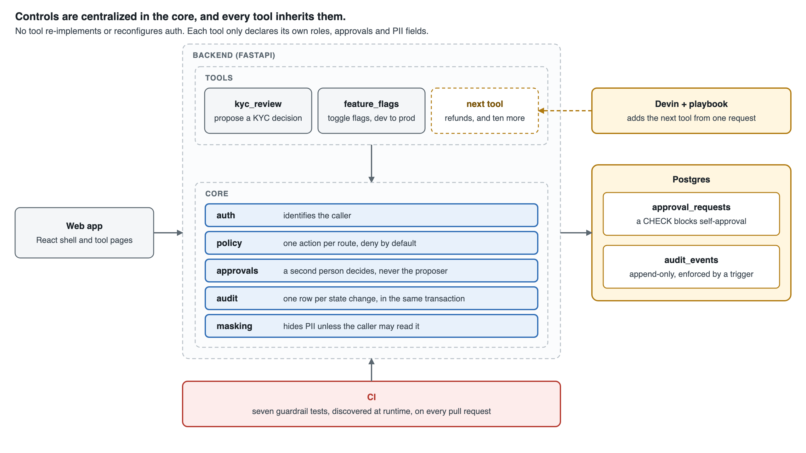
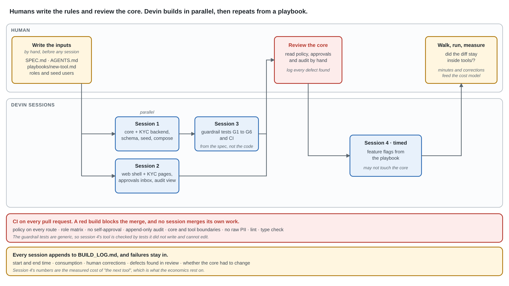
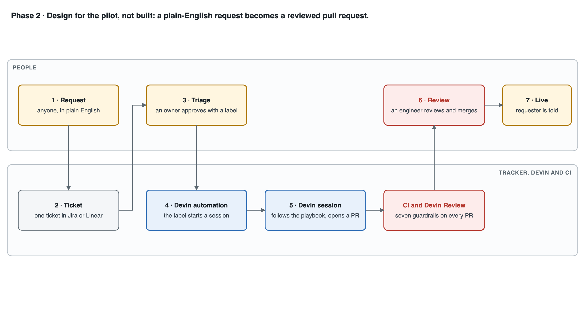

# Internal Tools Kit

A prototype for one question: can an engineering team use Devin to build its governed internal
tools, instead of paying for a low-code platform such as Microsoft Power Apps?

It does not rebuild Power Apps. There is no drag-and-drop editor, no connector catalogue and no
hosting. It rebuilds the part a fintech cannot skip: access control, second-person approval, an
audit trail and PII masking, written once in a shared core. Two tools sit on that core:

- **KYC review.** An analyst proposes a decision on a flagged case, a different senior reviewer
  approves it, and an auditor sees the trail with PII masked.
- **Feature flags.** Engineers toggle flags in dev and staging. A prod toggle needs approval from
  an engineering lead who is not the person asking. Every toggle is audited.

The claim under test: with the controls in a core, Devin can add the next tool from a
one-paragraph request without touching the core, and CI proves the controls still hold.

Not production. Synthetic data only. Login is a stub (pick a user, no password).



## Run it

Requires Docker with Compose.

```sh
docker compose up -d     # postgres :5432, backend :8000, web :5173
make seed                # drop + recreate the schema, load synthetic users, cases and flags
```

- Web app: http://localhost:5173 (the first start runs `npm install`, so give it a minute)
- API docs: http://localhost:8000/docs
- Health: http://localhost:8000/api/health

`make seed` is safe to rerun; it resets the database to the same fixed data every time.

## Try it

Pick a user on the login page. Switch users from the header at any time.

| User | Roles | Can |
|---|---|---|
| Ana | analyst | read KYC cases with PII, propose decisions |
| Sam | senior_reviewer | read KYC cases with PII, approve or reject proposals |
| Dana | analyst, senior_reviewer | propose and approve, but never her own proposal |
| Audrey | auditor | read KYC cases with PII masked, view flags, read the audit trail |
| Eli | engineer | view flags, toggle dev and staging, propose a prod toggle |
| Lee | engineer, eng_lead | everything Eli can, plus approve prod toggles that are not his own |

Two flows to walk through:

1. **KYC.** As Dana, open a case under KYC review and propose a decision. Open Approvals and try
   to decide it: the server refuses with `self_approval`. Switch to Sam and approve it. Switch to
   Audrey: the case shows `***` for PII, and Audit shows the propose, approve and apply rows.
2. **Feature flags.** As Eli, toggle a dev flag directly. Open a prod flag and propose a change
   with a reason. Switch to Lee and approve it in Approvals. Then propose one as Lee and try to
   approve it: refused, for the same reason and by the same core code as Dana.

The same KYC flow with curl:

```sh
API=http://localhost:8000/api
login() { curl -s -c "/tmp/$1.jar" -X POST $API/auth/login -H 'content-type: application/json' -d "{\"user_id\":\"$1\"}"; }
login dana; login sam; login audrey

# Dana proposes clearing case 2
curl -s -b /tmp/dana.jar -X POST $API/kyc/cases/2/propose \
  -H 'content-type: application/json' -d '{"decision":"clear","rationale":"Documents verified"}'

# Dana cannot approve her own proposal: 403 self_approval
curl -s -b /tmp/dana.jar -X POST $API/approvals/1/approve

# Sam can
curl -s -b /tmp/sam.jar -X POST $API/approvals/1/approve

# Audrey sees the trail
curl -s -b /tmp/audrey.jar "$API/audit?entity=kyc_case:2"
```

## Phase 1: the first few tools

This is how the prototype was built. It is also the recommended way for a team to start with
Devin: an engineer leads the first few tools, and what they correct is written down once so every
later session reuses it.



The rules were written before the first session: [SPEC.md](SPEC.md), [AGENTS.md](AGENTS.md),
[playbooks/new-tool.md](playbooks/new-tool.md) and the prompts in
[docs/DEVIN_SESSIONS.md](docs/DEVIN_SESSIONS.md). Devin wrote all the application code and tests
in four sessions and six pull requests. A human reviewed and merged each one.

Those rules, the playbook and the guardrail tests are the living knowledge. They are files in
this repo, and each session reads them before it starts. In this build, the nine corrections on
the first pull request turned into spec rules, three playbook steps and a seventh guardrail test.
The second tool then needed one correction.

| Session | Pull requests | Time | Devin usage | Human corrections |
|---|---|---|---|---|
| 1 Core and KYC backend | [#1](https://github.com/LavonASC20/internal-tools-kit/pull/1) | ~59 min, including two review rounds | $0.16 | 9 |
| 2 Web shell and KYC pages | [#2](https://github.com/LavonASC20/internal-tools-kit/pull/2), [#3](https://github.com/LavonASC20/internal-tools-kit/pull/3) | ~13 min to the first PR | $1.35 | 1 |
| 3 Guardrail tests and CI | [#4](https://github.com/LavonASC20/internal-tools-kit/pull/4) | ~13 min | $3.93 | 0 |
| 4 Feature flags, from the playbook | [#6](https://github.com/LavonASC20/internal-tools-kit/pull/6), kit fix [#5](https://github.com/LavonASC20/internal-tools-kit/pull/5) | ~5 min to a built tool, ~14 min to a reviewable PR | $4.30 | 1 |

Sessions 1 and 2 ran in parallel. Usage is the on-demand figure shown in each session's panel in
the Devin app. [BUILD_LOG.md](BUILD_LOG.md) has the full record for every session, including what
went wrong.

### What the second tool showed

- The feature flags diff is entirely inside `backend/tools/feature_flags/` and
  `web/src/tools/feature_flags/`. Nothing in `backend/core/`, `backend/tests/` or the web shell
  changed.
- The seven guardrail tests picked up the new routes and roles at runtime and passed unedited.
- Adding the tool did break two existing web tests, because they named specific users and grants.
  Devin stopped and reported it, and the fix went in as a separate kit change (#5).

### What it does not show

- Feature flags was named in the spec from the start, so the core was designed knowing this tool
  was coming. A tool nobody planned for is the real test, and it has not been run.
- One tool is one data point, and feature flags is close to plain CRUD. Nine corrections falling
  to one is a single comparison, not a trend.
- Review was the expensive part. Session 1 needed nine corrections before its core was safe to
  merge, including that any tool could grant any permission.

## Phase 2: requests from teams

This is a design for a pilot. It is not built here.

The second tool started from one plain-English paragraph. Once the living knowledge exists, the
next step is to let anyone file that paragraph as a ticket, have an owner approve it, and have
Devin pick it up from there. An engineer still reviews every pull request.



## Guardrails

These run in CI on every pull request. They discover routes, roles, tools and PII fields at
runtime, so a new tool is covered without anyone editing them.

| ID | Test |
|---|---|
| G1 | Every route declares a policy action, except health and the auth routes. |
| G2 | For every route and every role, the response is 403 exactly when the role lacks the action. |
| G3 | A proposer cannot decide their own request, through the API or by direct insert. |
| G4 | Audit rows cannot be updated or deleted. A change that fails midway leaves no state change and no audit row. |
| G5 | Core imports no tool. No tool imports another tool. |
| G6 | A caller without the PII action never receives raw PII values. |
| G7 | No tool grants or registers an action outside its own namespace. |

Each one was shown to fail when its rule is broken: session 3 made 17 temporary breakages and
pasted the failing output into [#4](https://github.com/LavonASC20/internal-tools-kit/pull/4).

## API

| Route | Action |
|---|---|
| `POST /api/auth/login {user_id}`, `POST /api/auth/logout`, `GET /api/me`, `GET /api/users` | auth (no action) |
| `GET /api/approvals?status=` | `approvals.read` |
| `POST /api/approvals/{id}/approve`, `.../reject` with optional `{comment}` | `approvals.decide`, plus the request's own approve action |
| `GET /api/audit?tool=&entity=&actor=&limit=` | `audit.read` |
| `GET /api/kyc/cases?status=`, `GET /api/kyc/cases/{id}` | `kyc.case.read` |
| `POST /api/kyc/cases/{id}/propose {decision: clear or reject, rationale}` | `kyc.decision.propose` |
| `GET /api/flags?environment=`, `GET /api/flags/{id}` | `flags.flag.read` |
| `POST /api/flags/{id}/toggle {enabled}` (dev and staging only) | `flags.flag.toggle` |
| `POST /api/flags/{id}/propose {enabled, reason}` (prod only) | `flags.prod.propose` |

`approvals.read` and `approvals.decide` are derived: a role holds them if it holds the propose or
approve action of any registered approval kind. `GET /api/me` returns the caller's actions.

Errors are `{"error": {"code", "message"}}`: 401 `unauthenticated`, 403 `forbidden` or
`self_approval`, 404 `not_found`, 409 `invalid_state`, 422 `validation_error`.

## Rules core enforces at startup

- **Action namespaces.** A tool's `permissions.py` sets `NAMESPACE` (KYC uses `kyc`, feature flags
  uses `flags`) and may only grant actions under it. Claiming another tool's namespace, or
  granting `audit.*` or `approvals.*` (owned by core), fails when the app starts. Each namespace's
  grants are registered once, and `create_app` freezes policy, so nothing can add or change a
  grant afterwards.
- **Approval kinds.** `approvals.register` accepts a kind only if its `action` and
  `propose_action` are declared actions in the registering tool's own namespace. Each action has
  one kind. Approval payloads must not contain PII field names: they are stored and shown unmasked.
- **PII masking.** Mark fields with `pii_field()` on a `PiiModel` and set `pii_action`. Core masks
  those fields whenever the model is serialized, unless the caller holds `pii_action`. Tools never
  call masking, and a `PiiModel` subclass may not define its own `model_serializer`. Every route
  that declares an action must return a pydantic model (or a list/optional of one), and a response
  model that uses `pii_field()` without being a `PiiModel` is refused when the route is created.

## Known gaps

Out of scope by design: real single sign-on (`core/auth` is a stub behind an interface), hosting,
connectors to systems of record, notifications and a visual editor.

Found during the build and left open:

- The namespace rules stop an honest mistake, not hostile code running in the same process.
- A field nobody marks with `pii_field()` is not PII to the kit. Only comments in `schema.sql`
  say otherwise.
- A wrong `pii_action` reveals PII to everyone who holds that action. Nothing checks it.
- PII inside a free-form `dict` field, a `computed_field`, or a hand-built `Response` is not masked.
- The PII checks on audit detail and approval payloads match key names only.
- A route with an action and no response body is refused at startup. It would need an empty model.
- `core/audit.py` names the `auditor` role, so a team that calls that role something else edits core.
- In mock mode, a browser that saved mock state before a tool was added gets errors from the new
  tool until its storage is cleared.

## Develop

```sh
python3 -m venv .venv && . .venv/bin/activate
make install             # backend runtime + dev dependencies
docker compose up -d postgres
make test                # pytest against a separate itk_test database (TEST_DATABASE_URL)
make lint                # ruff check, ruff format --check, mypy
```

The web app has its own commands in [web/README.md](web/README.md), including a mock mode that
needs no backend.

Layout (SPEC section 4):

```
backend/main.py          discovers backend/tools/* and mounts each tool's router under /api
backend/core/            auth, policy, approvals, audit, masking, db (+ errors, api routes)
backend/core/tests/      unit tests of core (import no tool)
backend/tools/<name>/    permissions.py, routes.py, service.py, schemas.py, schema.sql, seed.py, tests/
backend/tests/           generic guardrail tests (G1 to G7)
db/schema.sql            core tables: users, approval_requests, audit_events
db/seed.py               applies core + tool schema.sql, seeds users, calls each tool's seed.py
web/src/shell/           login picker, nav, approvals inbox, audit view
web/src/tools/<name>/    pages for one tool, discovered by glob
```

To add a tool, follow [playbooks/new-tool.md](playbooks/new-tool.md). `main.py`, `db/seed.py` and
the web shell find it by scanning the tools folders.
